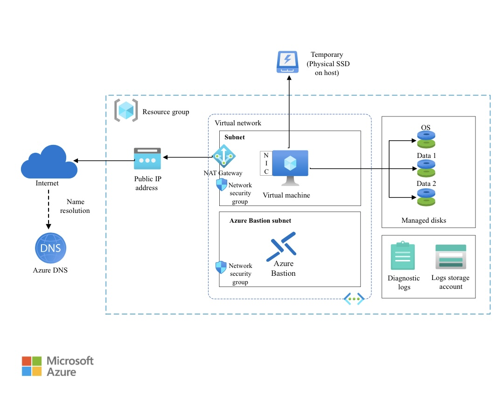
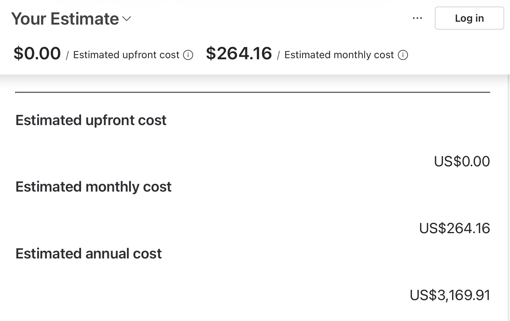

# stw-infra-live

Live environment for Stewardship. Composes all modules, each pinned to `v1.0.0`, and passes outputs between them.

## Modules

- Resource Group
- VNet
- Subnets + NSG
- Public IP
- Bastion
- NAT Gateway
- Storage Account
- VM + NIC
- Data Disks
- Monitoring (DCR)

## Usage

Generate a `terraform.tfvars` file (not committed) with:

```hcl
subscription_id = "<your subscription id>"
owner           = "<owner name>"
```

Then run:

```bash
terraform init
terraform plan
terraform apply
```
## Architecture



## Resources and why

| Resource | Why |
|----------|-----|
| Resource Group | Holds everything in one place, so it is easy to manage, tag and delete. |
| Virtual Network | Private network that isolates the workload from the internet. |
| VM Subnet + NSG | Subnet for the VM, with a Network Security Group that only allows SSH from the Bastion subnet. |
| Public IPs | One for Bastion and one for the NAT Gateway, created by a single reusable module. |
| Azure Bastion | Secure SSH access to the VM without exposing it to the internet. |
| NAT Gateway | Gives the VM outbound internet access with a fixed IP, while staying closed to inbound traffic. |
| Storage Account + container | Central, low-cost storage for Syslog data, as required by the Security Team. |
| Linux VM + NIC | The compute workload, with a managed identity so the monitoring agent can authenticate. |
| Data Disks | Separate managed disks for data, so it is kept apart from the OS disk. |
| Data Collection Rule + Azure Monitor Agent | Streams Syslog from every VM to the storage account, applied through a reusable module rather than inside the VM code. |

## Monthly cost

Estimated cost of running this solution in South Africa North: **US$264.16 per month** (about US$3,169.91 per year), with no upfront cost.

Estimate built with the Azure Pricing Calculator: https://azure.com/e/0ad9632f4d8647f1b58a2507b67c3208


## Challenges

| Problem | How it was fixed |
|---------|------------------|
| `terraform plan` failed because the Data Collection Rule Syslog source name was 40 characters, over the 32 limit. | Wrapped the generated names in `substr()` in the Monitoring module, then re-tagged `v1.0.0` and ran `terraform init -upgrade`. |
| Terraform reported duplicate variables, locals and resources in some modules. | The cached copy of the modules in `.terraform` was corrupted. Deleted the `.terraform` folder and ran `terraform init` again. |
| `apply` failed with `MissingSubscriptionRegistration` for the VM, disks and Data Collection Rule. | The subscription had not been registered for `Microsoft.Compute` and `Microsoft.Insights`. Registered both with `az provider register`. |
| `apply` failed with `SkuNotAvailable` for `Standard_B2s` and `Standard_D2s_v3` in South Africa North. | Azure had no capacity for those sizes. Checked the portal for available sizes and switched to `Standard_DS1_v2` as an input in this repo, with no module changes. |

Note: the diagram shows an NSG on the Bastion subnet too. This deployment only attaches one to the VM subnet, as the brief required.